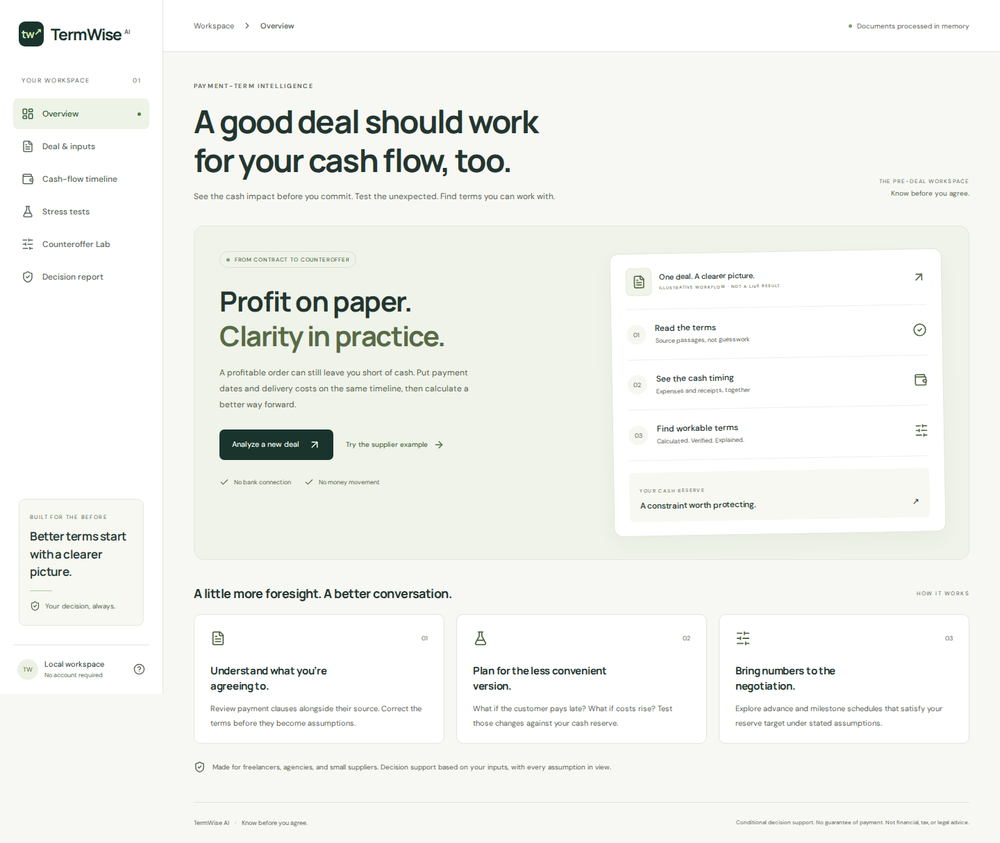

# TermWise AI

**Know before you agree.** Inspect payment terms, model cash timing, test adverse scenarios, and calculate alternative schedules that protect a chosen cash reserve.

TermWise AI is for freelancers, small agencies, and suppliers funding delivery before a customer pays. Financial arithmetic is deterministic Python, separate from document interpretation. No bank connections, money movement, automated emails, or arbitrary deal scores.



## Run locally

Requires **Python 3.12+**, **Node 22.12+** (Node 24 tested), and npm. From a clean clone:

```bash
git clone https://github.com/Ratnadeep-2007/TermWise-AI.git
cd TermWise-AI
python -m venv .venv
```

Activate the environment:

```bash
# Windows PowerShell
.venv\Scripts\Activate.ps1
# macOS / Linux
source .venv/bin/activate
```

Then install and build:

```bash
python -m pip install -r backend/requirements-dev.txt
cd frontend
npm ci
npm run build
cd ..
python -m uvicorn backend.app.main:app --host 127.0.0.1 --port 8000
```

Open **http://127.0.0.1:8000**. The built frontend and API share one origin. API reference: **http://127.0.0.1:8000/api/docs**. No model key is needed for the manual/example workflow or local rule extraction.

For frontend development, run the API as above and, in a second terminal, run `npm run dev` inside `frontend/`. Open http://localhost:5173. Vite proxies `/api` to the backend. The Python server reads `frontend/dist` when it starts, so rebuild and restart it after production changes.

## Try the connected workflow

1. Select **Try the supplier example**. The figures are fictional.
2. Optionally upload `sample_data/supplier-contract.pdf` or `.docx`, or extract the prefilled text. Inspect the original passages.
3. Review the contract value, opening cash, reserve, customer receipts, and costs. Check the confirmation box.
4. Calculate. Baseline minimum: **INR -40,000**; funding needed to maintain the INR 20,000 reserve: **INR 60,000**.
5. Open Stress tests. The 15-day delay produces **INR -90,000** because a separate INR 50,000 operating commitment falls before the delayed receipt. A 20% delivery-cost increase produces **INR -64,000**. Combined: **INR -114,000**.
6. Open Counteroffer Lab with advance date **2026-11-01**. A baseline search finds **30% / INR 60,000** as the smallest tested advance. Reduce the maximum to 29% to see an honest no-match result. Optional combined-stress protection needs 67% in this fixture; raise the bound to at least 67% to find it.
7. Generate the decision report, edit the draft, and download Markdown. Nothing is sent.
8. Change a financial input. All downstream results and confirmation are invalidated.

The extra operating commitment is separate from the INR 120,000 delivery costs in the simplified 30% advance example. The full event ledger is the calculation source of truth.

## What is implemented

- PDF, DOCX, TXT/Markdown, pasted text, and manual entry.
- Original source snippets and PDF page references; no invented DOCX page numbers.
- Conservative local extraction for explicit labeled amounts, percentages, and ISO dates.
- Optional OpenAI-compatible semantic extraction adapter; schemas and source-existence checks; manual confirmation remains mandatory.
- Exact Decimal ledger, reserve funding gap, cash shortfall, explicit intraday ordering, and event table.
- Five scenario controls: final/retention delay, delivery-cost increase, advance reduction, milestone delay, earlier delivery expenses.
- Bounded advance search with fixed chosen dates, optional extra milestone, preserved existing milestones/retention, and optional stress protection.
- Recalculated decision report, editable calculation-template negotiation draft, and Markdown download.
- Responsive UI, self-hosted fonts, reduced motion, loading/error/empty states, and automatic stale-result invalidation.

## Optional AI configuration

The default is **local rule-based extraction, not live semantic AI**. It recognizes lines like:

```text
Contract value: INR 200000
Advance: 30% on 2026-11-01
Final: 70% on 2027-01-15
```

It does not resolve arbitrary natural-language clauses or unknown acceptance dates. Enter or correct values manually. The original text remains available for review.

To enable semantic extraction, configure these server-side variables using your shell or process manager. Never put keys in frontend code or commit them:

```text
TERMWISE_AI_URL=<full compatible chat-completions URL>
TERMWISE_AI_MODEL=<your accessible model>
TERMWISE_AI_KEY=<your server-side key, if required>
```

Alternatively copy `.env.example` to `.env`, install `python-dotenv`, then pass `--env-file .env` to uvicorn. The environment file is not loaded implicitly.

The adapter uses a JSON chat-completions request, validates model output, rejects source passages not present in the document, and falls back on timeouts/invalid output. A valid citation proves the passage exists, **not that the interpretation is correct**. Review every material field. Provider costs, availability, and document retention depend on your chosen service. No live provider or extraction-accuracy claim has been verified in this build; provider tests use explicit mocks.

## Calculation rules

- All money uses Decimal with two decimal places; percentages round half up to cents. JSON money values are strings.
- Opening cash is available first. On any shared date, **all outgoing events occur before incoming events**. This can expose a temporary breach even when the end-of-day balance recovers.
- The reserve is checked at opening and after every event. A solver advance on the opening date cannot erase a reserve breach already present at opening.
- Contract receipts (advance/milestone/final/retention) must sum exactly to contract value. Other receipts are separate.
- One currency per deal; no conversion, taxes, holidays, or business-day adjustment.
- A reduced advance is deferred to the latest final payment. Earlier scenario expenses stop at the opening date. Final-payment delay applies to final and retention, not to advances, milestones, or unrelated income.
- Solver candidates preserve existing milestones/retention, replace advances, and combine final payments on the chosen date. They are ranked by smallest tested advance, with a disclosed step and upper bound. Dates are user-configured, not searched over every possible calendar.
- A no-match result means **no feasible candidate in the tested bounds**, not universal infeasibility.

## Test

```bash
python -m pytest -q
cd frontend
npm run build
npx playwright install chromium
npm run test:e2e
```

Playwright starts the production API/static server automatically. If a local instance already uses port 8000, stop it or ensure it serves the current build. CI uses a fresh server. Desktop and mobile profiles exercise intake, source review, calculation, stress tests, solver, report download, invalid totals, and stale-result invalidation.

For a preinstalled browser, optionally set `PLAYWRIGHT_CHROMIUM_EXECUTABLE` and JSON `PLAYWRIGHT_CHROMIUM_ARGS`. The build environment used a separately unpacked packaged Chromium because standard browser downloads were unavailable. That temporary runtime is not an application dependency.

See [evaluation/results.md](evaluation/results.md) for observed results and limitations; [docs/ENGINEERING.md](docs/ENGINEERING.md) for the engineering record.

## Architecture

| Area | Implementation |
| --- | --- |
| Workspace, API contracts, chart | `frontend/src/App.tsx`, `types.ts`, `Chart.tsx` |
| Typed input rules | `backend/app/schemas.py` |
| Shared ledger, stress transformations, candidate search | `backend/app/engine.py` |
| In-memory parsing and optional semantic adapter | `backend/app/extraction.py` |
| Verified report and editable draft template | `backend/app/reports.py` |
| API, headers, static assets | `backend/app/main.py` |

Data stays in the current browser tab and request memory. Refreshing discards the deal. No database is configured. Reports persist only when explicitly downloaded. Uploads are not saved by the application. A configured model provider receives the document text; its retention policies are separate. Request access logs contain route/status, not contract bodies. Avoid real sensitive documents in a public demo.

## Deployment

`Dockerfile` provides a single-process container serving frontend and API; port 8000. Build with `docker build -t termwise-ai .`, then run `docker run --rm -p 8000:8000 termwise-ai`. Docker packaging is provided; local Docker execution and a hosted deployment are **not verified**. This build is a single-user demo, without authentication, production rate limiting, or a persistent case store. Do not expose it for unrestricted sensitive-document processing.

## Hackathon and provenance

New implementation for **Build With AI: Basics**, started October 22, 2026 in the initially empty repository. No Synora code was copied. The official `challengepost/learn-ai-basics` skill pack was installed, read, and used to structure `devpost/` documents and mechanical checks. `skills-lock.json` records the installed pack; reinstall with `npx skills add challengepost/learn-ai-basics --all -y`.

The user supplied the product/build specification and explicitly delegated routine implementation decisions. Scope, PRD, and spec are **drafts awaiting review**, not invented approved interviews. The checklist leaves human hands-on review, learning wrap-up, demo recording, learner-written submission/exit survey, and submission unchecked. Installing the pack and generating documents alone is not a claim that the full curriculum has been completed.

Official rules: https://learn-ai-basics.devpost.com/rules . Deadline checked October 22: October 26, 2026 5 PM EDT / October 27, 2026 2:30 AM IST. Public demo video under three minutes and public code repository are required. Deployment is optional. Follow the current official rules and actual form if they change.

## License

MIT for original TermWise AI code. Dependency licenses and attribution remain with their respective authors; see [THIRD_PARTY_NOTICES.md](THIRD_PARTY_NOTICES.md) and `licenses/`. Calculations are conditional decision support, not financial, tax, or legal advice or a guarantee of payment.
